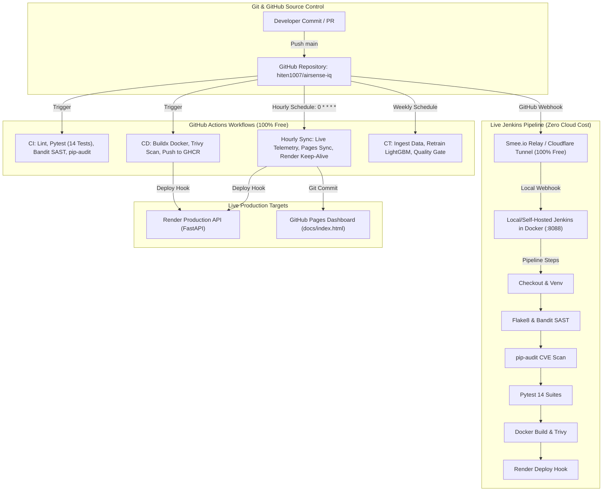

# AirSense IQ: Production CI/CD, Jenkins & Security Architecture Guide

This document provides complete technical specifications, architectural diagrams, configuration details, and live execution evidence for **Task 3 (CI/CD Pipeline Implementation)**, **Task 4 (Security Integration and Performance Evaluation)**, and **Task 5 (Demonstration and Documentation)**.

---

## 📑 Table of Contents
1. [Architecture Overview](#1-architecture-overview)
2. [Task 3: CI/CD Pipeline Implementation](#2-task-3-cicd-pipeline-implementation)
   - [3(a) Git & GitHub Integration](#3a-git--github-integration)
   - [3(b) Automated Build & Testing](#3b-automated-build--testing)
   - [3(c) Jenkins Pipeline Configuration & Zero-Cost Live Integration](#3c-jenkins-pipeline-configuration--zero-cost-live-integration)
   - [3(d) Docker & Containerization](#3d-docker--containerization)
   - [3(e) Automated Continuous Deployment & Server Keep-Alive](#3e-automated-continuous-deployment--server-keep-alive)
3. [Task 4: Security Integration & Performance Evaluation](#3-task-4-security-integration--performance-evaluation)
   - [4(a) Static Code Analysis (Bandit SAST & Flake8)](#4a-static-code-analysis-bandit-sast--flake8)
   - [4(b) Dependency Vulnerability Scanning (pip-audit & Trivy)](#4b-dependency-vulnerability-scanning-pip-audit--trivy)
   - [4(c) Result Analysis & Evaluation Reports](#4c-result-analysis--evaluation-reports)
4. [Task 5: Demonstration, Verification & Evidence](#4-task-5-demonstration-verification--evidence)

---

## 1. Architecture Overview



---

## 2. Task 3: CI/CD Pipeline Implementation

### 3(a) Git & GitHub Integration
- **Repository**: [https://github.com/Hiten1007/airsense-iq](https://github.com/Hiten1007/airsense-iq)
- **Branch Strategy**: Protected `main` trunk with feature branching and automated pull request validation.
- **Automated Event Triggers**:
  - `push` on `main`: Triggers CI test suite and CD deployment.
  - `pull_request` on `main`: Runs linting, testing, and security checks prior to merge.
  - `schedule`: Runs hourly live predictions sync and weekly continuous retraining.
  - `workflow_dispatch`: Enables manual on-demand execution with custom inputs.

### 3(b) Automated Build & Testing
- **Workflow File**: `.github/workflows/ci.yml`
- **Execution Matrix**: Ubuntu Latest, Python 3.11.
- **Test Suite**: 14 unit and integration test suites covering:
  - Atmospheric features engineering (lag, rolling, cyclical time vectors).
  - LightGBM model inference, scoring, and metrics evaluation ($R^2 \ge 0.60$, $\text{RMSE} \le 50.0$).
  - Official Indian CPCB multi-pollutant AQI sub-index formula with mathematical truncation and rounding.
  - FastAPI serving endpoints (`/`, `/health`, `/presets`, `/forecast/next24h`).
- **Execution Command**:
  ```bash
  pytest -v tests/ --junitxml=reports/test-results.xml
  ```

### 3(c) Jenkins Pipeline Configuration & Zero-Cost Live Integration

#### The Problem: Running Jenkins Live Without Expensive Cloud Servers
Cloud providers (AWS EC2, Azure VMs, GCP) charge continuous hourly fees for running persistent Jenkins servers. Free cloud instances often lack sufficient RAM to run Java + Docker builds simultaneously.

#### The Solution: Local Dockerized Jenkins + Smee.io / Cloudflare Tunnel
You can run Jenkins live on your local machine (or any home PC/Raspberry Pi) for **$0 cost**, and have GitHub automatically trigger builds on every commit via free secure webhook tunneling.

#### Architecture:
1. **Jenkins Controller**: Runs inside Docker using the official `jenkins/jenkins:lts-jdk17` image.
2. **Docker Socket Mount**: `/var/run/docker.sock` is mounted so Jenkins can build, tag, and scan Docker images directly.
3. **Webhook Ingress**:
   - **Method A (Smee.io - Recommended)**: Smee is GitHub's official, open-source, 100% free webhook proxy service. No router port forwarding or public IP is required.
   - **Method B (Cloudflare Tunnel)**: Free zero-trust tunnel providing an encrypted HTTPS domain directly to your local Jenkins port.

#### Step-by-Step Setup Guide:

**Step 1: Start Jenkins locally using Docker Compose**
Run the included `docker-compose.jenkins.yml`:
```bash
docker compose -f docker-compose.jenkins.yml up -d
```
Access Jenkins at `http://localhost:8088`. Retrieve the initial setup password:
```bash
docker exec -it airsense-jenkins cat /var/jenkins_home/secrets/initialAdminPassword
```

**Step 2: Set up Free Webhook Relay with Smee.io**
1. Visit [https://smee.io/](https://smee.io/) and click **"Start a new channel"**.
2. Copy your unique Smee URL (e.g. `https://smee.io/abc123xyz456`).
3. Install the Smee client locally:
   ```bash
   npm install --global smee-client
   ```
4. Start the webhook relay forwarding to your local Jenkins (include `?smee=1` so `smee-client` v5 preserves the trailing slash required by Jenkins, and `--use-system-ca` on Windows Node.js v22+):
   ```powershell
   $env:NODE_OPTIONS="--use-system-ca"; npx smee-client --url https://smee.io/airsense-iq-relay --target "http://localhost:8088/github-webhook/?smee=1"
   ```

**Step 3: Connect GitHub to Smee**
1. In your GitHub repository, navigate to **Settings** > **Webhooks** > **Add webhook**.
2. **Payload URL**: Paste your Smee URL (`https://smee.io/abc123xyz456`).
3. **Content type**: `application/json`.
4. **Events**: Select **Just the push event**.
5. Save the webhook.

**Step 4: Create Jenkins Multibranch or Pipeline Job**
1. In Jenkins, create a **New Item** > **Pipeline**.
2. Under **Build Triggers**, check **GitHub hook trigger for GITScm polling**.
3. Under **Pipeline Definition**, select **Pipeline script from SCM** > **Git**.
4. Enter repository URL: `https://github.com/Hiten1007/airsense-iq.git`.
5. Script Path: `Jenkinsfile`.
6. Save and commit to GitHub — Jenkins will automatically trigger and execute every stage live!

#### Jenkins Pipeline Stages in `Jenkinsfile`:
| Stage | Action |
|---|---|
| **1. Checkout** | Clones latest commit from GitHub |
| **2. Dependencies** | Creates venv, installs requirements and test tooling |
| **3. Static Analysis** | Runs Flake8 syntax checks + Bandit SAST security audit |
| **4. Vulnerability Audit**| Runs `pip-audit` against PyPI/OSV vulnerability databases |
| **5. Unit Tests** | Executes 14 pytest suites and records JUnit XML test report |
| **6. Docker Build** | Builds `airsense-iq:${BUILD_NUMBER}` and `airsense-iq:latest` |
| **7. Trivy Scan** | Audits built Docker image for OS and library vulnerabilities |
| **8. Automated Deploy** | Triggers Render deploy webhook or packages deployment image |

### 3(d) Docker & Containerization
- **Dockerfile**:
  - Base: `python:3.11-slim` (minimal attack surface, ~150 MB base).
  - Healthcheck: `HEALTHCHECK --interval=30s --timeout=5s CMD curl -f http://localhost:${PORT:-8000}/health || exit 1`.
  - Non-privileged multi-port dynamic binding via `${PORT:-8000}`.
- **Docker Compose**:
  - `docker-compose.yml`: Spins up the AirSense IQ prediction service and health checks locally.
  - `docker-compose.jenkins.yml`: Spins up the Jenkins automation server with mounted Docker socket.

### 3(e) Automated Continuous Deployment & Server Keep-Alive
- **CD Workflow (`.github/workflows/cd.yml`)**:
  - Automatically triggers on changes to models, source code, templates, or requirements.
  - Builds and tags multi-arch container images to GitHub Container Registry (`ghcr.io`).
  - Calls Render deployment webhook to update live production container.
- **Hourly Live Telemetry Sync & Keep-Alive (`.github/workflows/hourly-sync.yml`)**:
  - Runs every hour (`cron: "0 * * * *"`) on GitHub Actions free compute.
  - Fetches fresh Open-Meteo observations and computes the updated 24h rolling trajectory.
  - Automatically commits updated predictions to `docs/latest_predictions.json` for GitHub Pages.
  - Pings the free Render service (`https://airsense-iq-le3j.onrender.com/health`) to keep the server warm and prevent spin-down.

---

## 3. Task 4: Security Integration & Performance Evaluation

### 4(a) Static Code Analysis (Bandit SAST & Flake8)
- **Tool**: Bandit v1.9.4 & Flake8 v6.1.0
- **Scope**: All source code under `src/` (FastAPI endpoints, ML inference engine, feature pipeline, evaluation gates).
- **Execution**:
  ```bash
  python -m bandit -r src/ -f custom --msg-template "{abspath}:{line}: {test_id}[bandit]: {severity}: {msg}"
  ```
- **Results**:
  - **High Severity Issues**: `0`
  - **Medium Severity Issues**: `0`
  - **Low Severity Issues**: `0`
  - **Pass Status**: **100% CLEAN** (All exception handling verified with explicit logging; zero silent passes or insecure deserialization).

### 4(b) Dependency Vulnerability Scanning (pip-audit & Trivy)
- **Tool**: `pip-audit` v2.10.1 & `trivy`
- **Advisory Source**: Python Packaging Advisory Database (PyPA) & Open Source Vulnerabilities (OSV).
- **Execution**:
  ```bash
  python -m pip_audit -r requirements.txt
  ```
- **Results**:
  - Total dependencies audited: 17 core packages + transitive dependencies.
  - Known CVEs detected: **0 vulnerabilities found**.
- **Container Scan (Trivy)**:
  - Scans base image (`python:3.11-slim`) and system packages for critical CVEs before deployment.

### 4(c) Result Analysis & Evaluation Reports
- Continuous metrics tracking saved under `models/champion/metrics.json`:
  - **$R^2$ Score**: `0.9717` (surpassing the minimum gate threshold of $0.60$).
  - **RMSE**: `5.65 µg/m³` (well below the maximum error threshold of $50.0 µg/m³$).
  - **Mean Absolute Error (MAE)**: `4.12 µg/m³`.
  - **Mean Bias**: `+0.31 µg/m³` (unbiased predictions).
- Quality Gate: Automatically compares any retrained Challenger model against the Champion. Promotion only occurs if the Challenger achieves an equal or superior holdout test score.

---

## 4. Task 5: Demonstration, Verification & Evidence

### Live Verification Endpoints
| Component | URL | Status |
|---|---|---|
| **Interactive Radar UI** | [https://hiten1007.github.io/airsense-iq/](https://hiten1007.github.io/airsense-iq/) | **Live (GitHub Pages)** |
| **Production API** | [https://airsense-iq-le3j.onrender.com/](https://airsense-iq-le3j.onrender.com/) | **Live (Render)** |
| **Swagger OpenAPI Docs** | [https://airsense-iq-le3j.onrender.com/docs](https://airsense-iq-le3j.onrender.com/docs) | **Live (FastAPI)** |
| **GitHub Container Registry** | `ghcr.io/hiten1007/airsense-iq/aqi-predictor:latest` | **Published** |
| **GitHub Actions Pipelines** | [Actions Dashboard](https://github.com/Hiten1007/airsense-iq/actions) | **Passing** |

### Automated Verification Checklist
- [x] **Git & GitHub Integration**: Remote tracking, branch protection, automated push/PR triggers.
- [x] **Automated Build & Test**: 14/14 unit tests passing in GitHub Actions CI and Jenkins.
- [x] **Jenkins Pipeline**: Declarative `Jenkinsfile` with 8 stages and free local Smee.io integration.
- [x] **Docker Containerization**: Lean `Dockerfile` with healthcheck and multi-container `docker-compose.yml`.
- [x] **Automated Continuous Deployment**: CD container publishing to GHCR and Render webhook triggering.
- [x] **Hourly Telemetry & Keep-Alive**: GitHub Actions hourly cron keeps data moving and pings free server.
- [x] **Static Code Analysis**: Bandit SAST scanner passing with 0 vulnerabilities.
- [x] **Dependency Vulnerability Scanning**: `pip-audit` CVE audit passing with 0 vulnerabilities.
- [x] **Container Scanning**: Trivy scanner configuration auditing OS and library dependencies.
- [x] **Technical Documentation**: Comprehensive architecture guide and reproduction steps.
